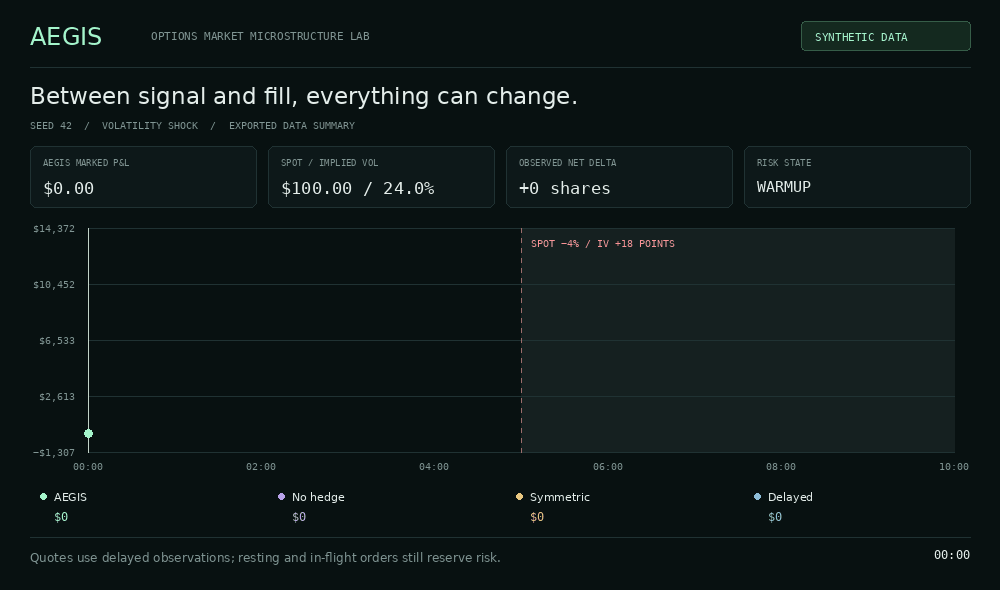

# AEGIS · Options market microstructure lab

**What happens between a trading decision and its execution?** AEGIS makes that gap visible: a miniature exchange, four market-making policies, delayed observations, and a risk engine replayed on the same synthetic market tape.



**Start here:** open [`artifacts/report.html`](artifacts/report.html) in a desktop browser. It contains the complete interactive replay, including charts, contract books, a portfolio stress heatmap, and trade downloads. No server, account, API key, or Python installation is needed to view it. The animation above is a summary rendered from exported data; the HTML contains the full interface.

### What is implemented

- A price/time-priority order book with integer price ticks, partial fills, post-only orders, immediate-or-cancel orders, and self-match prevention.
- An integer-time event scheduler separating venue truth from delayed trader observations. Quotes, hedges, and cancellations arrive after simulated latency.
- European option prices, six Greeks, and bracketed implied-volatility inversion, with explicit unit conventions.
- Inventory-skewed quotes and underlying delta hedges, compared with three simpler or slower policies.
- Risk reservations covering live **and in-flight** option orders, plus drawdown and stale-feed latches.
- An integer-cent cash ledger and P&L attribution that reconciles execution edge, revaluation, hedging costs, and fees.
- Four scenarios × four policies, seeded reproduction, event hashes, full audit exports, and local matching benchmarks.
- 33 automated tests, including randomized matching invariants, finite-difference Greeks, future-data independence, delayed shutdowns, and accounting reconciliation.

### Run it

The simulator uses only the Python standard library and requires Python 3.11 or later. From the extracted project directory:

```bash
python scripts/test.py
python scripts/run.py demo --seed 42 --ticks 600
```

On systems where the executable is named `python3`, substitute `python3`. The second command regenerates all 16 experiments and their exports in `artifacts/`.

To explore one experiment or measure matching:

```bash
python scripts/run.py simulate --scenario vol_shock --policy delayed --seed 42 --ticks 600 --out artifacts/runs/delayed
python scripts/run.py benchmark --iterations 20000
```

An optional editable install exposes the same commands as `aegis`:

```bash
python -m pip install -e .
aegis demo
```

### Explore the replay

1. Open the report and choose **Volatility shock**. Drag the time control before the halfway mark, then inspect a contract's quotes.
2. Select **Jump to event**. The spot gaps down 4% and IV jumps 18 percentage points before delayed observations arrive.
3. Compare **AEGIS**, **No hedge**, **Symmetric**, and **Delayed**. They share an external tape and the same risk limits; their fills differ.
4. Filter the audit to **Risk**. A kill switch stops submissions and schedules cancellations; positions remain exposed.
5. Inspect the stress heatmap and P&L reconciliation. Export the selected run's trades for independent inspection.

### Experiment design

| Policy | Inventory skew | Delta hedging | Order / cancel delay | Feed delay |
| --- | --- | --- | --- | --- |
| AEGIS | Yes | Yes | 80 ms | 60 ms |
| No hedge | Yes | No | 80 ms | 60 ms |
| Symmetric | No | No | 80 ms | 60 ms |
| Delayed | Yes | Yes | 1,600 ms | 300 ms |

Scenarios cover ordinary flow, upward directional pressure, a spot/IV shock, and a 15-second feed outage. The default universe has 12 synthetic European options: calls and puts at three strikes and two expiries.

The bundled seed-42 experiment illustrates a useful failure: AEGIS's $500 drawdown trigger fires at 300.060 seconds in the shock scenario, while its full-run drawdown reaches about $3,051. The jump occurs before the control can react, and remaining positions continue to revalue. A risk trigger is a decision rule, not a guaranteed loss cap. See the complete [results and measurements](docs/RESULTS.md).

### Read the engineering

| File | Purpose |
| --- | --- |
| [Architecture](docs/ARCHITECTURE.md) | Event ordering, observation boundaries, reservation lifecycle, and accounting |
| [Model assumptions](docs/MODEL.md) | Pricing units, execution rules, synthetic flow, and limitations |
| [Results](docs/RESULTS.md) | All 16 outcomes and precisely scoped benchmark measurements |
| [Validation](docs/VALIDATION.md) | Checks that passed and the browser verification limitation |
| [Interview walkthrough](docs/INTERVIEW.md) | A demo script, concepts to learn, and a factual resume description |
| [GitHub setup](docs/GITHUB_SETUP.md) | Upload instructions and repository presentation |

### Scope

This is a reproducible systems experiment with synthetic data. The flow and spreads are deliberately favorable to market making during ordinary conditions; simulated dollar results are not historical returns, forecasts, or evidence of a tradable edge. The model uses flat IV, immediate local fill accounting, and a simplified competitor. There is no broker adapter, exchange connectivity, live-market calibration, or automatic liquidation. Final inventory is marked to model; the displayed exit cost is an estimate and is not deducted from P&L. Benchmark timings measure an isolated Python operation in one process.

MIT license. Portfolio project for Bhavya Bhavsar, developed with AI assistance. Understanding and explaining the model, assumptions, and tests is part of the project.
