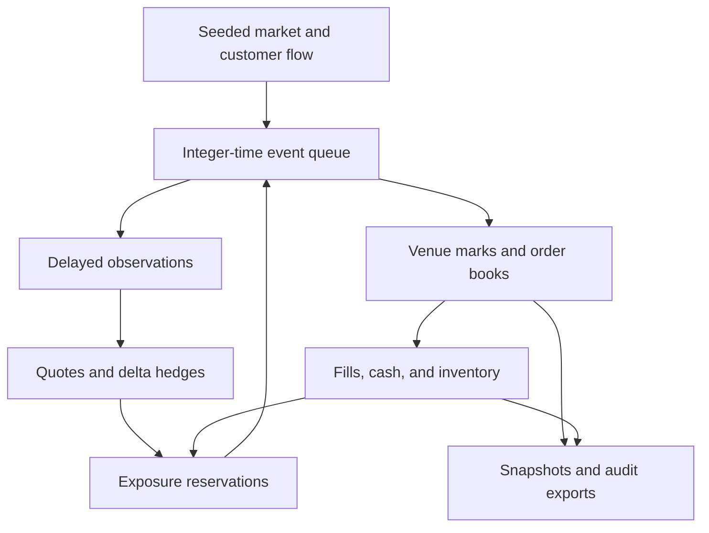

# Architecture

AEGIS separates an external synthetic market, an exchange, and a trader with delayed observations. Each policy runs independently against the same pre-generated external tape. Policies interact with the rival and customers, but do not compete against each other in one shared book.

## Modules

| Module | Responsibility |
| --- | --- |
| `pricing.py` | Black–Scholes–Merton prices, Greeks, IV inversion |
| `market.py` | Instrument definitions, seeded scenarios, customer-flow tape |
| `book.py` | Heap-based price/time priority, cancellation, matching, depth |
| `portfolio.py` | Cash, positions, exposure, attribution, full-repricing stress |
| `risk.py` | Conservative order reservations and latched loss/freshness controls |
| `engine.py` | Event scheduling, policy decisions, execution, session drainage |
| `cli.py` | Experiment generation, CSV/JSON/JSONL exports, embedded report |
| `benchmark.py` | Isolated matching microbenchmark with measurement metadata |
| `templates/` | Offline HTML replay and JavaScript pricing/stress functions |

## Clock and data domains

The queue key is `(timestamp_ms, insertion_sequence, event_kind, payload)`. The sequence breaks ties deterministically. Market frames are one second apart; customer orders and message arrivals can occur within each second. Future events are scheduled, but the strategy receives only an `Observation` containing the delivered timestamp, spot, IV, and regime. It receives no customer-flow list or future frame.

At venue time, the engine changes true marks and reprices the rival's book. A delayed observation later updates the trader's marks. Quote, hedge, and risk decisions use those observed marks. Evaluation, fill-time fair values, and post-run markouts use venue truth.

Fill reports update the local portfolio immediately: execution-report latency is not modeled. Consequently, this isolates market-data and order/cancel latency, rather than reproducing every communication channel.

## Quote and hedge lifecycle

The quoting policy starts with an observed model price. Inventory skew moves the quote center against inventory; a spread adjustment accounts for observed IV and current inventory magnitude. Each side submits one contract, rounded outward to integer cents.

Before scheduling a quote, the gate reserves its potential exposure. The reservation survives while the order is in flight and while it rests. Existing reservations also survive a cancellation request. At venue arrival, the gate rechecks current observed exposure, then the book applies post-only rules. Rejections release the reservation. A partial fill reduces the same order object's remaining quantity; a complete fill or cancel releases the remainder.

The hedge policy rounds observed delta to shares, applies its 65-share threshold, and caps one hedge request at 500 shares. A pending hedge contributes to the conservative delta reservation. At arrival, a hedge is rejected if it would no longer reduce observed absolute delta or if the circuit has opened.

## Matching

Each side has a heap indexed by price priority followed by arrival sequence. A live-order dictionary supports cancellation. Heap entries for canceled orders are discarded lazily. Opposing prices that cross trade at the resting order's price, up to the smaller remaining quantity. IOC remainders never rest. A post-only incoming order that would cross is rejected. Incoming orders encountering the same owner's resting order have their remainder canceled.

The rival refreshes three levels per side at every venue frame. Its newly aggressive orders can cross stale AEGIS quotes; those executions are accounted as fills. Assuming stale quotes vanish at a price update would conceal the shock failure this experiment is designed to expose.

## Risk and shutdown

Absolute positions plus all remaining option reservations bound per-contract and gross exposure. Delta and vega reservations add absolute contributions for both bid and ask; the engine assumes neither offsetting fills nor instant cancellation. These bounds are conservative at the observed snapshot, and future prices or Greeks can change exposure.

Drawdown is measured from the observed P&L high-water mark, initially zero. The first loss, stale-feed, delta, or vega breach latches the gate. New option orders and hedges stop; cancellation messages still take the configured latency. The latch never silently resets after a recovered feed.

Session close follows the same drainage principle. The event queue runs until remaining message events have been processed. Final assertions require zero outstanding AEGIS orders and reservations. Neither session close nor a kill switch liquidates inventory.

## Accounting and reproduction

Cash and fees use integer cents. Inventory valuation uses unrounded model marks. The accounting identity is:

`P&L = execution edge + option revaluation + underlying revaluation − hedge slippage − fees`.

The engine verifies the identity against cash plus marked positions within $0.000001. Exported display components are rounded and can differ from displayed P&L by several millionths of a dollar.

The tape, complete run result, and replay suite each receive SHA-256 hashes of canonical JSON. Benchmark timings are separate and are not deterministic. Identical seeds, parameters, source, and runtime floating-point behavior reproduce the same trace; exact hashes across different Python/platform versions are not guaranteed. Tests also change future frames and verify that earlier decisions stay unchanged.
